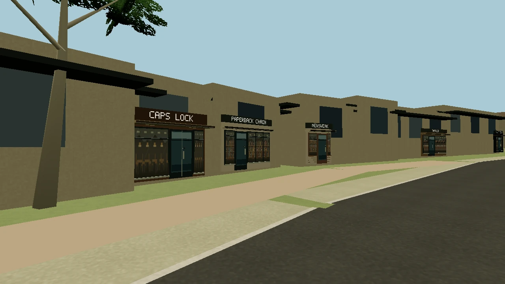
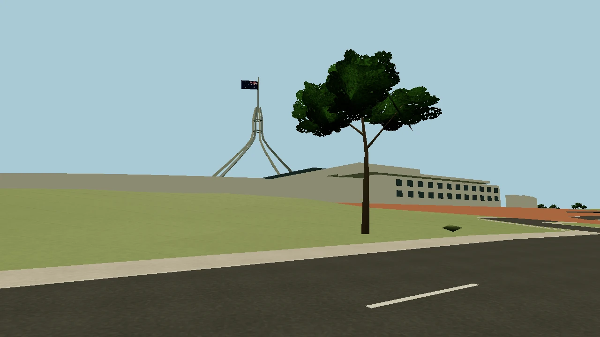
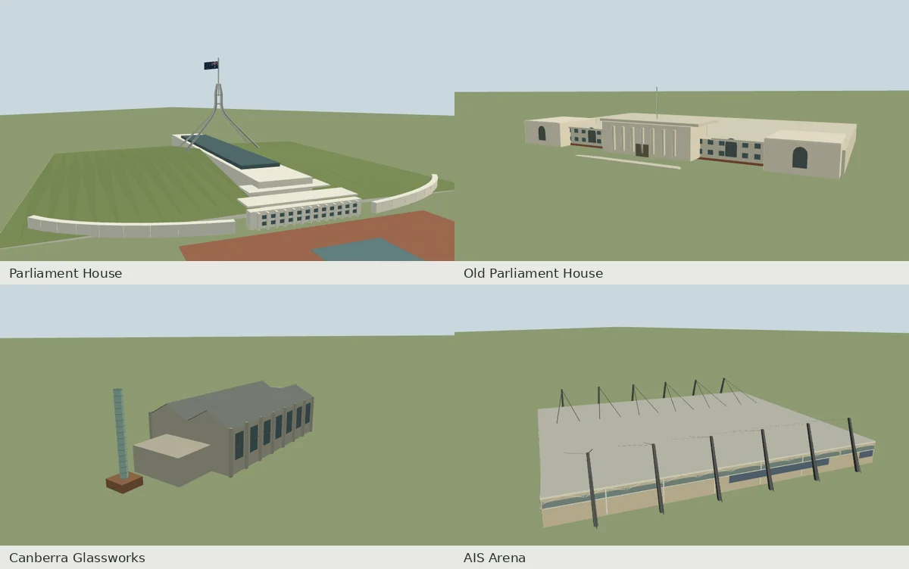
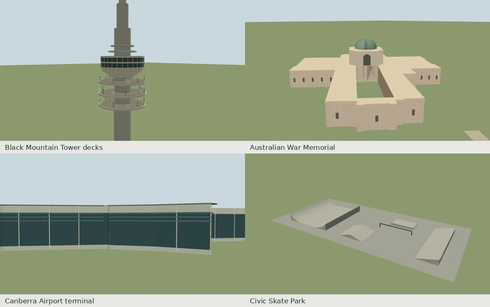

# Capital Drive landmark exteriors

The composed map currently contains 162 landmark records, 398 other searchable places and 88 regional place records. These sets overlap. They include suburbs, transit stops, parks and services as well as buildings. The five Inner South landmark models and 25 named regional building exteriors below can be checked independently against their geometry in the game.

## Individual public exteriors

| Place | Details represented | Public reference |
| --- | --- | --- |
| Parliament House | Four faceted stainless pylons rake inward, bend into an open vertical cluster and carry the flag above the grass roof. The model retains an 81 m mast above the 18 m roof crest. The flag has a folded fly, a canton and stars. | [Parliamentary Education Office](https://peo.gov.au/understand-our-parliament/parliament-house/australias-parliament-house), [Australian Stainless Steel Development Association](https://www.assda.asn.au/blog/209-monumentally-successful) |
| Old Parliament House | Four arched, bronze-framed glazed bays, cream stone-coloured reveals and stepped parapet bands across the white front elevation. Bay spacing, the terrain and stair dimensions are approximate. | [Museum of Australian Democracy heritage plan](https://www.moadoph.gov.au/sites/default/files/2023-01/MoAD-Heritage-Management-Plan-2021-26.pdf) |
| Kingston Powerhouse / Canberra Glassworks | Paired industrial gables, roughcast concrete, multipaned steel windows and a projecting central parapet. Warren Langley’s *Touching Lightly* rises 23 m, with a 2 m diameter glass shaft and horizontal bands. | [Australian Institute of Architects heritage citation](https://www.architecture.com.au/wp-content/uploads/r012_kingston_powerhouse_rstca.pdf), [artist’s project page](https://www.warrenlangley.com.au/project/touching-lightly/) |
| Manuka Oval | The Jack Fingleton Scoreboard sits on the four shipped corners of OSM way 1290130248. Its shutters face the pitch along the infield side. Face height, shutters and colours are an interpretation. Six floodlight towers and stepped stands define the wider ground. | [Manuka Oval history](https://manukaoval.com.au/about-manuka-oval/history/), [venue diagram](https://manukaoval.com.au/wp-content/uploads/2019/04/Manuka-Oval-Map-with-Media-Centre_2019.pdf), [source footprint](https://www.openstreetmap.org/way/1290130248) |
| Manuka Pool | Existing terrain-following perimeter, open gate between two pillars, cream entrance buildings with terracotta hip roofs, roof tile courses, geometric sun rays and the mapped basin. | [Site outline](https://www.openstreetmap.org/way/51677758), [basin outline](https://www.openstreetmap.org/way/58851110) |
| Dickson Library | Enrico Taglietti’s low building has a projecting concrete fascia with a shaded soffit over manganese-coloured brick and recessed-looking glazing. Its outer ring comes from OSM way 5124277. The overhang depth is an artistic estimate. | [ACT Heritage background](https://www.act.gov.au/__data/assets/pdf_file/0006/148344/dickson-library-background-information.pdf), [source footprint](https://www.openstreetmap.org/way/5124277) |
| Belconnen Library | A contrasting pale concrete fascia, strong horizontal cantilever and shaded glazing distinguish this library. The cantilever is compressed to keep nearby paths visually open. | [ACT Heritage registration](https://www.legislation.act.gov.au/DownloadFile/ni/2024-70/20240216-83181/PDF/2024-70.PDF), [Australian Institute of Architects](https://www.architecture.com.au/wp-content/uploads/r125_belconnen_library_chandler_street_belconnen.pdf) |
| AIS Arena | Twelve dark, raking masts and 36 stays rise against a pale roof. Triangular edge bracing and blue cladding sit above the lower walls. Their positioning follows cross-sections through the mapped, rotated building outline. The public project description supplies the counts. Height and individual cable profiles are estimates. | [FDC AIS Arena project](https://www.fdcbuilding.com.au/projects/ais-arena/), [exterior reference](https://www.coliseum-online.com/dernier-cri-look-for-australia-ais-arena/) |
| Belconnen Arts Centre | Graphite cladding, vertical panel joints, a contrasting light roof edge and glazing give the civic arts building its own palette. The model simplifies the centre’s different construction stages. | [DJAS project](https://www.djas.com.au/projects/belconnen-arts-centre-bac/) |

## Wider coverage

The regional renderer draws the exterior walls and roofs on the mapped building rings, including concave outlines and courtyards. Each of its 25 named owners gets a glazed entrance, a projecting canopy where the wall is wide enough, framed window bands and sills with shaded returns. Six families divide the secondary details between libraries, campuses, arenas, shopping centres, hospitals and exhibition buildings. Decorative entrances and lettering are artistic interpretations.

| Area | Buildings in this renderer |
| --- | --- |
| Acton | ANU Chifley Library, ANU Menzies Library, School of Music / Llewellyn Hall, Marie Reay Teaching Centre, Di Riddell Building, Kambri Culture Centre |
| North Canberra and Gungahlin | Dickson Library, Exhibition Park in Canberra, Gungahlin Leisure Centre, Gungahlin Public Library, Marketplace Gungahlin |
| Belconnen, Bruce and outer west | AIS Arena, Belconnen Arts Centre, Belconnen Library, Canberra International Sports and Aquatic Centre, University of Canberra, Westfield Belconnen, Kippax Public Library, Latham Shopping Hub |
| Woden, Tuggeranong and Molonglo | Canberra Hospital, Woden Library, South Point Tuggeranong, Tuggeranong Library, Coombs Shops, Denman Prospect Shops |

## Dedicated public exteriors elsewhere

| Place | Comparison with the game model | Reference |
| --- | --- | --- |
| Black Mountain Tower | The earlier model put dark glazing on every tier. Three open lower platforms now carry cream circular silhouettes beneath a distinct enclosed double window band, stepped soffit and upper open terraces. The top remains 195.2 m above the summit. The deck heights and rim profile are approximate. | [Telstra](https://www.telstra.com.au/telstra-tower), [public exterior photograph](https://bestinau.com.au/telstra-tower-canberra/) |
| Australian War Memorial | A tall arched window with a sandstone surround now articulates the Hall of Memory. A stepped stone cornice and narrow patinated seams on the copper dome catch the light. The outer wings and footprint of the open courtyard follow the source. The ceremonial pool, carvings and updated public foyer remain outside this model. | [National Capital Authority architectural history](https://www.nca.gov.au/sites/default/files/tear-war.pdf), [Memorial history](https://www.awm.gov.au/about/organisation/history), [public foyer](https://www.awm.gov.au/ourcontinuingstory/main-entrance) |
| Canberra Airport terminal | The architect’s public terminal has a broad glass front, metal roof edge and horizontal fins. The game adds a projecting, sloping eave and stacked blue-grey sunshades to the facades facing Terminal Avenue. They share the terminal roof datum so the fins meet adjacent walls on slopes. The roofline, street canopy and glass reflections remain simplified. | [Guida Moseley Brown Architects](https://www.gmbarchitects.com/projects/new-passenger-terminal/), [airport’s photographed public street elevation](https://www.budgetconsultation.act.gov.au/__data/assets/pdf_file/0016/2800303/47.-Canberra-Airport.pdf) |
| ANU University Avenue | Five mapped pedestrian sections now show pale rectangular paving in staggered courses, aligned to each section. A locally generated 64-pixel square tile supplies the joints and variation. It occupies 16 KiB before mipmaps and generates no network requests. | [Kambri](https://kambri.com.au/venues/university-avenue/), [ACT public-space design exemplar, photo 23](https://www.legislation.act.gov.au/DownloadFile/ni/2023-541/20231127-81884/PDF/2023-541.PDF) |
| Civic Skate Park / The Yard | The smooth ramp surface now meets a silvery worn coping strip with darker shoulders along the existing high, level crests. The curved ramp, banks, rails and their positions remain approximate within the ACT boundary. | [Local skatepark photographs](https://blog.skateboard.com.au/skateparks/australia/the-yard-skate-park/), [Skater Maps](https://skatermaps.com/the-yard-skate-park/) |
| Commonwealth Avenue and Kings Avenue bridges | Lower concrete edges and open metal railings preserve the view across Lake Burley Griffin. Both follow the existing five mapped roadway sections, sidewalk edges and supplied deck height. Plinth heights, colour and post spacing differ by bridge. The models retain their existing physical parapets. The real bridges have five and seven spans respectively; individual underwater supports and changes during construction have not been surveyed for the game. | [National Capital Authority](https://www.nca.gov.au/attractions/lake-burley-griffin), [Commonwealth Avenue exterior photograph](https://www.abc.net.au/news/2025-09-24/act-commonwealth-avenue-bridge-shrink-three-lanes-construction/105808342) |
| Telopea Park School | Its existing perimeter, entrance flags, rocks and heritage planter passed the focused rendering and collision suite. These are artistic street-side details. The campus buildings still use the available source footprints. | [School history](https://www.telopea.act.edu.au/about_our_school/history) |

The former waterpark at Macquarie retains its four mapped pool outlines and six slide routes. The Macquarie shopping precinct, Manuka and Kingston shopping precincts, commercial tenants, and Civic noodle restaurant use the separate shopping, storefront, Macquarie and noodle-shop views. Most houses and unnamed commercial buildings still use the streamed world renderer’s footprint-based architecture.

### Street-level geographic captures





The geographic harness loads the shipped Inner South terrain and street data, applies production road profiles and building replacements, then runs the normal low-graphics world streamer, real building and shop views, foliage atlas, daylight lighting, parked-car generator and streetlight renderer. The two 1280 × 720 captures use fixed pedestrian-height cameras. A playable session adds its HUD, player, moving actors, missions and changing weather. The Parliament Drive photograph loaded 20 world chunks and submitted 135,420 triangles. The Franklin Street photograph loaded 17 and submitted 137,470 triangles. The harness also reports tree, building and road segment counts.

To reproduce both images, install Python Playwright and Pillow, point the command at a local Chromium executable and run it from the repository root. It serves the checked-out files on a loopback port.

```sh
python scripts/capture_capital_street_views.py --chromium /usr/bin/chromium --output /tmp/capital-street-views
```

### Model studies

These images come from Chromium rendering the production geometry and materials with fixed daylight on a neutral ground plane. The close views isolate the geometric detail. Traffic, nearby buildings, sky, terrain and game HUD appear during normal play.





## Verification

Run from the repository root with Node:

```sh
node scripts/test_capital_landmarks.mjs
node scripts/test_capital_regional_landmarks_view.mjs
node scripts/test_capital_regions_actual.mjs
node scripts/test_capital_north_places_view.mjs
node scripts/test_capital_war_memorial.mjs
node scripts/test_capital_airport.mjs
node scripts/test_capital_anu.mjs
node scripts/test_capital_civic_extras.mjs
node scripts/test_capital_civic.mjs
node scripts/test_capital_campus.mjs
```

The five fixed models use 14,186 triangles across all detail levels and two shared materials. The 25 regional building models together contain 19,124 triangles. A camera at each of the 25 source footprints submitted at most 3,434 triangles in two opaque draws. Site detail switches at 280 m and its shell at 650 m. Geometry positions, normals, colours and terrain samples remain static. An index prefix changes only when the set of visible buildings changes. Frame rate on an Intel N100 was not measured in this test.

The Memorial uses 7,789 triangles across two distance-limited draws. The skatepark/storefront batch uses 2,282 across one draw. The two lake bridge parapets share one draw. Batching adjacent rails at the same grade gives 1,384 triangles on the shipped terrain, including 92 shoulder triangles. All 160 physical parapet segments remain. ANU paving and lawn retain two draws and fewer than 100 triangles. Airport generation remains limited to two cells per update and 28 residents.
