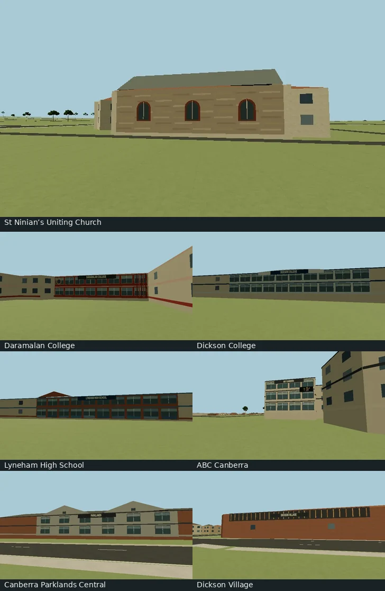

# Seven North Canberra landmark frontages

The Dickson and Lyneham scenery adds street-facing architectural detail to **seven existing OpenStreetMap building polygons**. Schools, shops and public buildings retain their original map footprints and interactions. These models use public descriptions and exterior photographs as references. All geometry, lettering, colours and the ambient digital display were authored for the game.

| Site and retained OSM building | What the player sees | Evidence and approximation |
| --- | --- | --- |
| Daramalan College · [way 814363817](https://www.openstreetmap.org/way/814363817) | Chapel-red masonry, closely spaced brick blades, window bands and a round glazed accent. | Stewart Architecture describes original red brick, later rounded windows and a two-storey performing arts centre. The frontage draws on that campus vocabulary. The retained geometry does not identify the performing arts centre itself. The other three saved buildings keep their ordinary exteriors. [Project architect](https://www.stewartarchitecture.com.au/project/daramalan-performing-arts-centre) |
| Dickson College · [way 41758411](https://www.openstreetmap.org/way/41758411) | A shallow curved silver-grey fascia, white lettering on a blue band and two levels of framed glazing. | The school's 2025 prospectus shows the curved grey frontage and navy-and-white building sign. Its form and colour guided the interpretation. Sign length, bay count and the selected elevation are estimated. [School prospectus, contents page](https://www.dicksonc.act.edu.au/__data/assets/pdf_file/0006/581523/Info_Night_Prospectus_2025_Dickson_College_website.pdf) |
| Lyneham High School · [way 56188595](https://www.openstreetmap.org/way/56188595) | Blue mosaic-like spandrels alternate between brick piers beneath a band of glass. A short blue-glazed gable changes the roof silhouette. | The school's anniversary cover shows brick, blue panels and two-storey glazing. Public exterior photographs also show a brick gable and sloping glass. These details are combined on one street elevation. Ten secondary building outlines keep the ordinary renderer. [School anniversary cover](https://www.lynehamhs.act.edu.au/__data/assets/pdf_file/0005/441419/60th_Anniversary_-_memories.pdf) · [ACT exterior photographs, cover](https://www.act.gov.au/__data/assets/pdf_file/0008/2854538/EDU_2025_008_Records_Stage-2_Part1.pdf) |
| St Ninian’s Uniting Church · [way 186854214](https://www.openstreetmap.org/way/186854214) | Rubble-toned stone courses, three brick-trimmed arched windows and a pitched ridge. | The heritage registration describes Black Mountain sandstone, the gable and an early extension that increased the side-window count from two to three. The historic church and later additions share a mapped footprint. The close treatment covers one side. Roof pitch and individual stones are approximations. [ACT heritage registration, description](https://www.legislation.act.gov.au/ni/2011-740/current/pdf/2011-740.pdf) |
| ABC Canberra · [way 50637171](https://www.openstreetmap.org/way/50637171) | Three storeys of glazing with a high-contrast amber digital temperature display. | The ABC documents the well-known public clock and thermometer outside its Canberra studios. The game reinterprets that feature as a wall-mounted sign with a fixed 18-degree reading. The display position, tint and facade bays are illustrative. [ABC account and exterior image](https://www.abc.net.au/news/2016-04-28/abc-canberra-clock-thermometer-back-online/7367632) |
| Canberra Parklands Central Apartment Hotel · [way 67499704](https://www.openstreetmap.org/way/67499704) | Paired dark roof gables, small upper windows and rows of recessed-looking glazing against grey walls. | A public photograph shows paired two-storey grey blocks with dark tiled rooflines and upper gables. The model brings that silhouette to one edge of the highly articulated footprint. Its gables, materials and spacing are approximate. [Public street photograph, cover](https://dafinder.blob.core.windows.net/dadocuments/DOCs/SCRITERIA-202341555-01.PDF) |
| Dickson Village · [way 1222397180](https://www.openstreetmap.org/way/1222397180) | Timber-toned vertical fins on dark upper retail screening, a projecting fascia and lettering above the existing shops. | Public images show the retail elevation. The completed six-storey development also includes homes above the shops. The frozen map supplies one broad 6.4 m estimated retail mass with no separately sourced upper residential footprints. The new geometry dresses only the podium. The upper apartment volumes remain a fidelity gap. [Completed project photographs](https://www.ancr.com.au/wp-content/uploads/project_gallery/dickson_village.pdf) · [Project architect](https://i2c.com.au/dickson-village-opens/) |



The preview uses the production street and building renderer with terrain, roads and source footprints in a Chromium software WebGL harness. Each view uses a 2.1 m camera height. Time of day, traffic and people are outside this geometry study.

## Rendering and checks

Each added facade uses the actual ground polygon to choose and orient a long face. The direction, span, dimensions and material colours are estimates. Additions are scaled to the existing height and the same sampled ground convention as the ordinary building. Brick, hotel, school and broadcast-office elevations carry their spandrel colours around polygon corners. The six lettered elevations share a single 512 × 256 local atlas. St Ninian’s uses geometry for the arched windows and masonry throughout. The scene creates no extra network request, light, collision shape, search target or interior.

The geometry totals **1,769 static triangles** across seven facades with the complete label atlas. Each site takes one opaque geometry draw, plus at most one label draw, within 280 m. Distance checks toggle visibility without rebuilding geometry. The focused check samples every one of the seven frontages, confirms the original polygon coordinates and building ownership, culls every draw at long distance, and verifies that the atlas is disposed once. The full composed map contains 20 distinct linked school and landmark building footprints for these seven places, of which seven receive this treatment.

```sh
node scripts/test_capital_north_places_view.mjs
node scripts/test_capital_north_west.mjs
```

The underlying map data and source selection are documented in the [North and West Canberra source record](capital-drive-north-west-sources.md).
