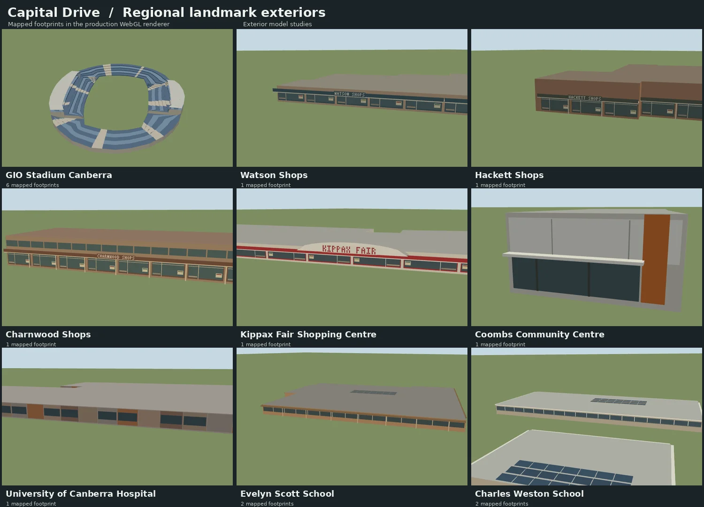

# Regional landmark exteriors

Nine named places use 16 mapped building footprints in Capital Drive. The stadium keeps its pitch open. The two schools each feature a pair of mapped buildings, and the hospital treatment covers one mapped wing. Building heights follow the shipped source estimates. Facade divisions, shade projections, canopy profiles, seat arrangements and solar array placements are scaled artistic interpretations.



The studies show the production WebGL geometry on a flat plane in fixed daylight. In the playable world, the same renderer samples local terrain and shares the existing shop, traffic, collision, map and interaction systems. The preview contains original low-poly artwork. Public photographs served as references and were not embedded.

| Named place | Exact OSM building ways unless marked as a relation | Exterior treatment and public reference |
| --- | --- | --- |
| GIO Stadium Canberra | North 57769381, west 57769631, east 57769638, south 57769717, Mal Meninga 57769207, Gregan Larkham 57769270 | Raked rows of blue-grey seats and pale aisles follow the six individual footprints. The two named upper stands carry shallow canopies. Row counts and roof heights are simplified. [Venue seating plan](https://giostadiumcanberra.com.au/ticketing/seating-plan/) |
| University of Canberra Hospital | 519783390 | One mapped, single-level hospital wing gets dark window bays and alternating terracotta, grey and brown panels. The source building carries the same 20 Guraguma Street address as the hospital. The guide shows the broader multistorey hospital complex. [Canberra Health Services exterior photograph, p. 12](https://www.canberrahealthservices.act.gov.au/__data/assets/pdf_file/0003/2436330/Welcome-to-rehabilitation-at-University-of-Canberra-Hospital.pdf) |
| Hackett Shops | 256143627 | A warm masonry strip, sheltered shop windows and a row of individual display bays face Hackett Place. [Hackett Community Association, 2018 shop photographs](https://hackett.asn.au/wp-content/uploads/website-version-April-2021-book-of-Hackett-.pdf) |
| Watson Shops | 543790961 | The named one-storey retail polygon carries an intermittent run of shopfronts, shared projecting fascia, varied displays and window transoms along its Watson Place side. [Historical street photograph](https://commons.wikimedia.org/wiki/File:Watson_shops_canberra_act_sign.jpg) |
| Charnwood Shops | 372148527 | The two-level retail building named Fadco Building gets shaded display windows, a high window band and spaced supports toward Charnwood Place. It represents one building in the group centre. [ACT City Services precinct upgrade and photographs](https://www.cityservices.act.gov.au/Infrastructure-Projects/programs/suburban-infrastructure-program/completed-projects/charnwood-shops-safety-improvements) |
| Kippax Fair | Relation 9912221 | A curved pale canopy, red lettering, dark glass and projecting fascia face the Hardwick Crescent side. Two unclosed OSM outer members join to form the real retail footprint. [ACT Kippax Group Centre Master Plan, p. 67](https://www.planning.act.gov.au/__data/assets/pdf_file/0003/2356752/kippax-group-centre-master-plan-2019.pdf) |
| Charles Weston School | 548101848, 548101852 | Pale low roofs, long window ribbons, shadowed eaves and shallow roof solar arrays distinguish these single-storey wings. [ACT Infrastructure Plan, school photograph](https://www.treasury.act.gov.au/__data/assets/pdf_file/0004/1034482/Infrastructure-Plan-Update-2016-17.pdf) · [ACT construction photograph with roof arrays](https://www.treasury.act.gov.au/__data/assets/pdf_file/0009/805734/2015-16-Infrastructure-Plan.pdf) |
| Evelyn Scott School | 1248982164, 1248982162 | Earth and ochre finishes, sheltered external glazing, projecting shade, light supports and roof arrays. [Hayball project photographs and design statement](https://www.hayball.com.au/projects/evelyn-scott-p-10-school/) · [Building Services Engineers, onsite solar](https://www.bse.com.au/project/evelyn-scott-school/) |
| Coombs Community Centre | 1134389463 | Pale cladding panels, black-framed glazing and an orange corner treatment follow the operator’s photograph. The named 110 Woodberry Avenue source estimates a single level, so the game compresses the upper facade band. [YWCA Canberra exterior photograph](https://ywca-canberra.org.au/wp-content/uploads/YWCA_AnnualReport_2023_Website.pdf) |

## Selecting and verifying the buildings

The renderer matches both the landmark ID and its exact OSM source reference, then requests only the building IDs in the table. GIO’s venue outline remains a pitch. Its six buildings carry the corresponding bowl and grandstand names in the source. The selected hospital building and every vertex of each selected school building were checked against the relevant campus polygons in the pinned regional OSM tiles. Each school component also carries the building=school tag. Four precinct labels retain their original separate public map coordinates. Facades on the commercial sites align to the mapped building edge facing the named shopping street. Precise entrances and tenant layouts were not surveyed.

The Kippax Fair shell joins outer ways 27243622 and 713272037 from relation 9912221 into a ring with 15 distinct corners. The composed map retains one physical building for this relation and separate buildings for the library and health centre. All other new exterior treatments replace the generic appearance of an existing building after geometry validation. Building collision and ground coordinates continue to come from the map. [OSM attribution](https://www.openstreetmap.org/copyright)

Run the renderer and composition tests from the repository root.

```sh
node scripts/test_capital_regional_landmarks_view.mjs
node scripts/test_capital_regional_expansion.mjs
node scripts/test_capital_regions_actual.mjs
node scripts/test_capital_west_belconnen.mjs
node scripts/test_capital_molonglo.mjs
```

The composed regional renderer has 41 source buildings across 34 named sites. All geometry shares two opaque vertex-colour batches with zero textures. It stores 25,767 triangles and submitted a maximum of 3,434 triangles at the tested source footprints. GIO alone submitted 2,570 triangles nearby and zero outside its 650 m range. Facade and seating detail culls at 280 m. These are geometry measurements. Hardware FPS was not measured. The regression also checks that stadium triangles remain inside stand polygons, missing owners retain fallback, and asymmetric facade lettering reads correctly on both polygon windings.
