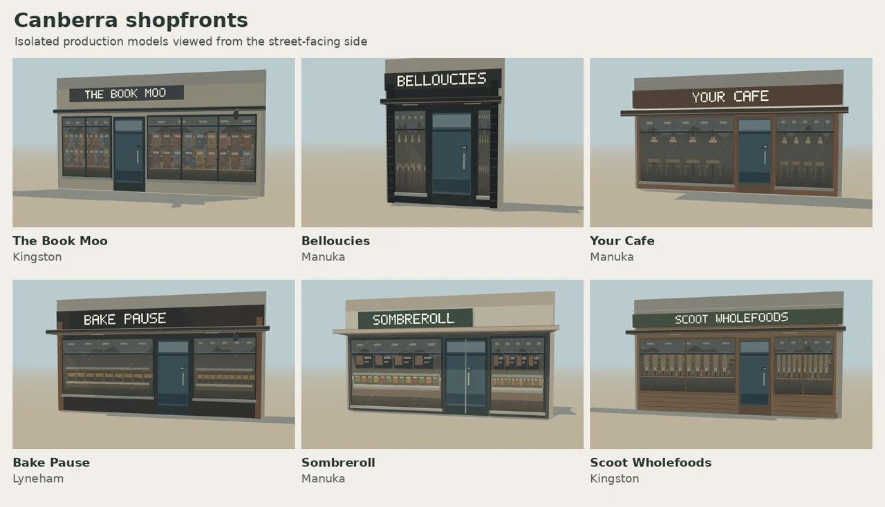
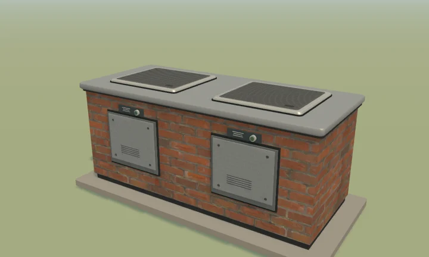
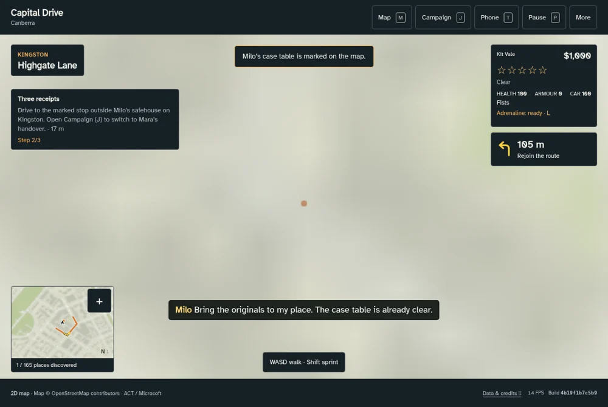
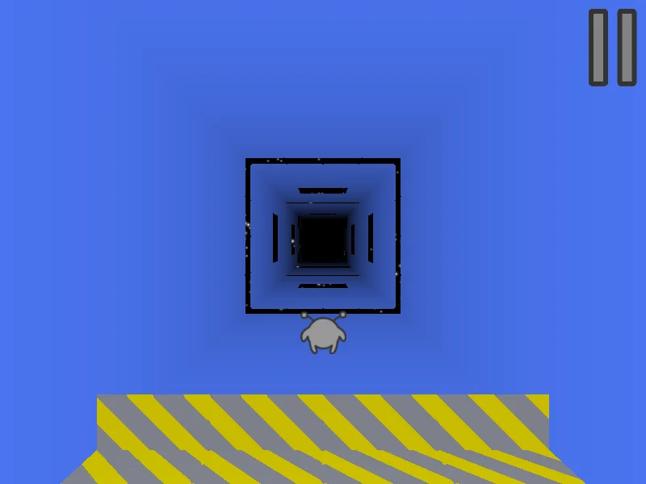

# Canberra and arcade release previews

| View | What was captured |
| --- | --- |
| [Franklin Street, Manuka](../../capital-drive-previews/landmark-studies/manuka-street.webp) · [Parliament Drive](../../capital-drive-previews/landmark-studies/parliament-street.webp) | Street-level views from the geographic renderer with actual roads, buildings, terrain and foliage. |
|  | Six isolated shopfronts rendered by the game. The models use parody names. [Tenant-by-tenant sources](../../capital-drive-shopfront-architecture.md) |
| [Canberra landmarks](../../capital-drive-previews/landmark-studies/inner-and-west.webp) · [Northern and eastern landmarks](../../capital-drive-previews/landmark-studies/north-and-east.webp) | Eight model views from the game renderer. [Public references and model budgets](../../capital-drive-landmark-fidelity.md) |
|  | Standalone view of the model assigned to ACT register entry BBQ429. The tile is an original photographic material from Poly Haven. |
|  | Campaign dialogue in the game's 2D compatibility mode. Native controls selected the mission and switched between its two routes from a fixture with the previous chapters completed. |
|  | The browser entered Explore and accepted steering and jump controls after the level files were repaired. |
| [Arcade on a phone](arcade-mobile.webp) | Actual 390 px Chromium viewport. Player counts describe the number of human players supported by the edition. |

## Gameplay and source checks

- [All 142 game project entries and individual gameplay evidence](../arcade-fleet-playtest-2026-11-26.md)
- [Defensive source and browser review](../arcade-defensive-review-2026-11-26.md)
- [Arcade mobile presentation and accessibility review](../arcade-presentation-2026-11-26.md)
- [ACT park fixture positions, attribution and filtering](../../capital-drive-park-amenities.md)
- [Streetlight locations and bounded rendering](../../capital-drive-streetlight-columns.md)

The road check covered 27,417 roads, 155,465 source segments and 639,234 static lane clearance probes. There were 1,465 occupied probes on 305 roads. A control run with all 191 park fixtures removed produced the same results. Individual occupied probes need case-by-case inspection. The run does not establish that every vehicle can drive every possible turn.

## Pedestrian setup profile

A Chromium CPU trace of the 3D startup and initial Free roam session exposed
repeated pavement checks against road segments and long shorelines. The
distance calculation in the pedestrian module accounted for 82.9 seconds of
self samples in the largest call branch. This trace used software WebGL on a
shared four-core host. Its 275-second time to Ready describes that particular
instrumented run. [Interactive flame graph](boot-flame.html)

The pedestrian builder now indexes the edges of long polygons by horizontal
band and checks segment bounds before computing distance. Sidewalks still
use the original sample spacing, road offset and physical clearances.
On the full composed map, pedestrian setup measured 44.7 CPU seconds before
and 4.6 CPU seconds after. Both builds produced 29,563 paths, and the sampled
actor positions after resets matched byte-for-byte across the spawn and four
landmarks. This benchmark uses flat height sampling to isolate path construction.

```sh
node scripts/profile_capital_sidewalks.mjs
node scripts/test_capital_pedestrians.mjs
node --expose-gc scripts/profile_capital_shopping.mjs
```
