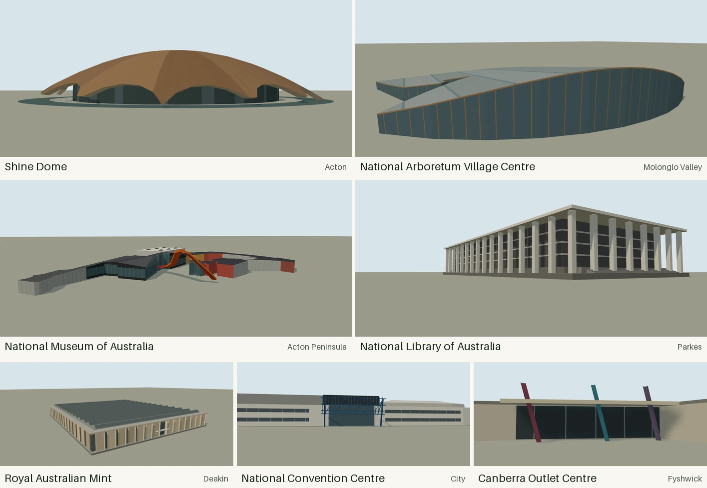

# Canberra and arcade release previews

| View | What was captured |
| --- | --- |
| [Franklin Street, Manuka](../../capital-drive-previews/landmark-studies/manuka-street.webp) · [Parliament Drive](../../capital-drive-previews/landmark-studies/parliament-street.webp) | Street-level views from the geographic renderer with actual roads, buildings, terrain and foliage. |
| [Free roam at Telopea Park School](free-roam-telopea.webp) | Actual 1280 × 800 WebGL session using the Performance preset on build `3b359ed1b628`. The normal startup, cache, mobile and desktop version badges, scene rendering, map search and Free roam teleport all passed. |
| [Driving on New South Wales Crescent](free-roam-driving.webp) | Starting from rest near Telopea Park School, W moved the car 4.38 m. Adding D turned it 4.8° and brought the odometer to 6.70 m. The HUD shows 41 km/h in second gear. Captured at 720 × 450 on the Performance preset in a separate software WebGL session on build `3b359ed1b628`. |
| [Six arcade games in play](arcade-games.webp) | Actual browser sessions, including both Subway editions and Super Hot. Individual outcomes are in the fleet report. |
|  | Six isolated shopfronts rendered by the game. The models use parody names. [Tenant-by-tenant sources](../../capital-drive-shopfront-architecture.md) |
| [Canberra landmarks](../../capital-drive-previews/landmark-studies/inner-and-west.webp) · [Northern and eastern landmarks](../../capital-drive-previews/landmark-studies/north-and-east.webp) | Eight model views from the game renderer. [Public references and model budgets](../../capital-drive-landmark-fidelity.md) |
|  | Production model geometry drawn on the shipped footprints with daylight and flat ground. The camera rises above the Arboretum, Museum and Mint to show their roof shapes. [Capture details](#national-and-regional-building-captures) |
| [Five Civic shopfronts](civic-shopfronts.webp) | Distinct Garema Place and Bunda Street facades. [Frontage sources and WebGL measurements](../capital-drive-civic-storefronts-2026-11-26.md) |
| [Nine regional landmarks](regional-exteriors.webp) · [Seven North Canberra frontages](../../capital-drive-previews/landmark-studies/north-frontages.webp) | Includes GIO Stadium, Kippax Fair and street-level buildings in Dickson and Lyneham. [Regional references](../../capital-drive-regional-exteriors.md) · [Northern references](../../capital-drive-north-frontages.md) |
|  | Standalone view of the model assigned to ACT register entry BBQ429. The tile is an original photographic material from Poly Haven. |
|  | Campaign dialogue in the game's 2D compatibility mode. Native controls selected the mission and switched between its two routes from a fixture with the previous chapters completed. |
|  | The browser entered Explore and accepted steering and jump controls after the level files were repaired. |
| [Arcade on a phone](arcade-mobile.webp) | Actual 390 px Chromium viewport. Player counts describe the number of human players supported by the edition. |

## National and regional building captures

The sheet uses Chromium WebGL and the game's full-detail triangle emitters. Each panel isolates a single building. Its flat ground allows the feet, eaves and entrances to be inspected without trees or nearby buildings obscuring them. Camera heights are relative to that ground. The counts cover the building geometry alone. [Footprint register](../../capital-drive-landmark-coverage.md)

| Building | OSM way | Camera height | Triangles | Visible feature |
| --- | ---: | ---: | ---: | --- |
| Shine Dome | 4970449 | 1.7 m | 1,632 | Copper shell arching over recessed glazing |
| National Arboretum Village Centre | 663660535 | 17 m | 803 | Rising glazed face and tapering roof |
| National Museum of Australia | 5035476 | 43 m | 1,200 | Orange forecourt loop, white hall roof and coloured wings |
| National Library of Australia | 5954392 | 1.7 m | 1,178 | Continuous shaded eave above the colonnade |
| Royal Australian Mint | 217376654 | 30 m | 737 | Stepped roof profile and public entrance |
| National Convention Centre | 210305032 | 2.1 m | 830 | Constitution Avenue's blue steel entrance screen |
| Canberra Outlet Centre | 30160608 | 1.7 m | 287 | Close view of the angled posts at the Iron Knob Street entrance |

Reproduce the sheet from the repository root with Chromium, Python, Pillow and Playwright installed.

```sh
python -B scripts/capture_capital_national_buildings.py --output docs/verification/arcade-canberra-2026-11-26/national-buildings.webp
```

## Gameplay and source checks

- [All 142 game project entries and individual gameplay evidence](../arcade-fleet-playtest-2026-11-26.md)
- [Defensive source and browser review](../arcade-defensive-review-2026-11-26.md)
- [Arcade mobile presentation and accessibility review](../arcade-presentation-2026-11-26.md)
- [ACT park fixture positions, attribution and filtering](../../capital-drive-park-amenities.md)
- [Streetlight locations and bounded rendering](../../capital-drive-streetlight-columns.md)

The initial road check, before the additional Kippax Fair building was joined from its two map ways, covered 27,417 roads, 155,465 source segments and 639,234 static lane clearance probes. There were 1,465 occupied probes on 305 roads. A control run with all 191 park fixtures removed produced the same results. Individual occupied probes need case-by-case inspection. The run does not establish that every vehicle can drive every possible turn.

## Release and offline play

Chromium passed all eight build checks on `3b359ed1b628`. A separate cold, warm and offline session passed 20 checks. The real career wallet, garage, job progress and inventory survived a reload with the network disconnected, and W/D controls worked offline. On the warm start, the server sent zero game-module or map response bodies. The worker update fixture passed another 24 checks, including activation of a changed build and keeping a pre-existing save.

The release inventory covers 136 listed games and six unlisted projects. The fleet test used 267 short runs plus game-specific checks. Native gameplay input was verified in 139 titles. The [per-game report](../arcade-fleet-playtest-2026-11-26.md) names the three exceptions and distinguishes a working control from completing a game.

## Pedestrian setup profile

A Chromium CPU trace of the 3D startup and initial Free roam session exposed
repeated pavement checks against road segments and long shorelines. The
distance calculation in the pedestrian module accounted for 82.9 seconds of
self samples in the largest call branch. This trace used software WebGL on a
shared four-core host. Its 275-second time to Ready describes that particular
instrumented run. [Interactive flame graph](boot-flame.html)

The pedestrian builder now indexes the edges of long polygons by horizontal
band and checks segment bounds before computing distance. Sidewalks still
use the original sample spacing, road offset and physical clearances.
On the full composed map, pedestrian setup measured 44.7 CPU seconds before
and 4.6 CPU seconds after. Both builds produced 29,563 paths, and the sampled
actor positions after resets matched byte-for-byte across the spawn and four
landmarks. This benchmark uses flat height sampling to isolate path construction.

```sh
node scripts/profile_capital_sidewalks.mjs
node scripts/test_capital_pedestrians.mjs
node --expose-gc scripts/profile_capital_shopping.mjs
```
