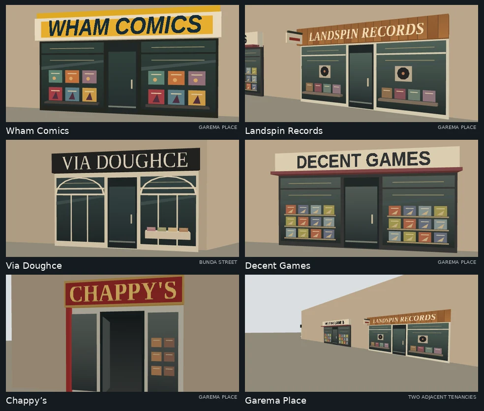

# Five Civic shopfronts

These five premises were already searchable, staffed and enterable. Their former 3D fronts shared one design. Each now has its own entrance treatment at the existing public interaction point. Four shops share one mapped building. Chappy’s occupies a separate footprint. OpenStreetMap supplies the shop positions and building outlines. Individual frontage widths and doors are estimates.

| In-game shop | Public exterior reference and interpretation |
| --- | --- |
| Wham Comics | The photographic reference shows the yellow upper strip and the large white-backed sign above dark glazing. The covers and lettering are original. [Impact Comics in Garema Place](https://hercanberra.com.au/event/impact-comics-book-garden-69b7d4190939a13839a5cac4/) |
| Landspin Records | Timber boards, white transoms and a hanging blade give the frontage a different silhouette as you approach from the side. [Landspeed Records exterior photograph](https://concreteplayground.com/canberra/shop/landspeed-records) |
| Via Doughce | The Bunda Street corner has black fascia and white arched glazing. The counter includes small gelato tubs. The former enclosed Garema Place gazebo was removed in 2025. [Exterior photograph and gazebo history](https://www.abc.net.au/news/2025-07-28/city-renewal-authority-gazebo-via-dolce-garema-place-removal/105583202) · [Canberra City Centre counter photograph](https://www.inthecity.com.au/explore/via-dolce-pasticceria) |
| Decent Games | A broad pale fascia and mixed boxed displays draw on a photographed Games Capital frontage at 38 Garema Place. The operator confirms the Good Games rebrand. Its current exterior colour scheme remains unverified. [Historical exterior](https://good-games-canberra-city.wheree.com/) · [Operator and address](https://events.goodgames.com.au/organiser/good-games-canberra-city/) |
| Chappy’s | The real restaurant has a compact red-and-gold sign above a shaded entrance, with menu photos at the side. The game leaves the central doorway clear and uses an interpreted café room. [Happy’s entrance photograph](https://region.com.au/happys-chinese-restaurant-celebrates-60-years-in-garema-place/614375/) |

The preview uses the shipping shop renderer and mapped building outlines with flat pavement and fixed lighting. The shops and nearby skatepark share one draw call and one locally generated 512 × 128 lettering texture. Chromium submitted 916 triangles beside Wham Comics and all 1,066 beside Via Doughce, where the skatepark is also in range. The previous model submitted 2,282 when visible. A distant focus submits zero. Repeated updates within the same visibility region leave the geometry buffers untouched.

Run the focused scene with `python3 -B scripts/test_capital_civic_storefronts_browser.py`. Its optional `--preview FILE.webp` saves the gallery. Run `node scripts/test_capital_civic_extras.mjs` for physical alignment, individual details, the no-canvas lettering fallback and culling. Run `node scripts/test_capital_shop_staff.mjs` for the 34 staffed shop interiors and usable counters. The 2D compatibility renderer uses its existing map view. These measurements cover the Civic batch and do not establish whole-game frame rate on the target Intel N100.
